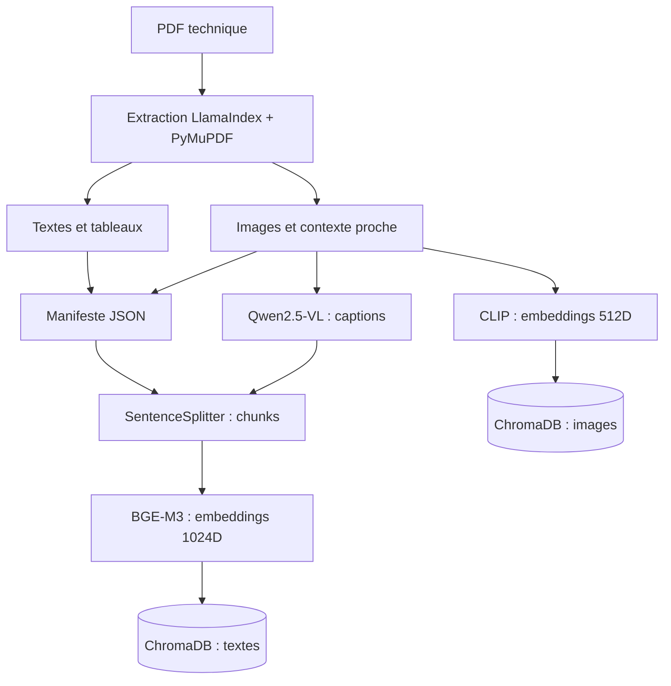
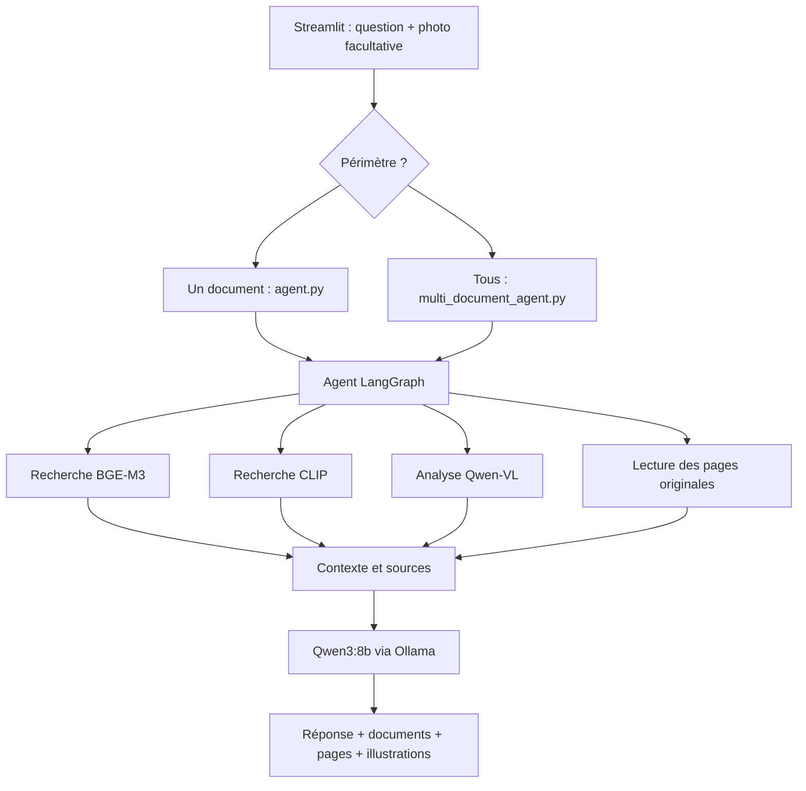

# 🔧 MaintiDoc — Assistant RAG agentique multimodal

**MaintiDoc** est un assistant documentaire pour les techniciens de maintenance. Il interroge des manuels PDF contenant du texte, des tableaux et des images, accepte une photographie utilisateur et génère des réponses contextualisées avec des références aux documents.

**Périmètre de ce dépôt : partie 1 — RAG agentique multimodal.** Le prototype fonctionne localement avec **Streamlit, LangChain/LangGraph, Qwen via Ollama, LlamaIndex, BGE-M3, CLIP et ChromaDB**. L'utilisateur choisit un manuel précis ou une recherche dans **tous les manuels déjà indexés**.

> **Attention :** les descriptions et réponses générées automatiquement peuvent contenir des erreurs. Une référence à une page ne prouve pas à elle seule chaque affirmation. MaintiDoc ne commande aucun équipement et ne remplace pas un technicien habilité.
>
> Le fine-tuning, MCP, l'historique des interventions, les tickets avec validation humaine et le déploiement sont **hors du périmètre actuel**.

## Sommaire

- [Fonctionnalités](#fonctionnalités)
- [Architecture](#architecture)
- [Technologies](#technologies)
- [Démarrage rapide](#démarrage-rapide)
- [Pipeline de préparation d'un PDF](#pipeline-de-préparation-dun-pdf)
- [Recherche et agents](#recherche-et-agents)
- [Organisation des fichiers](#organisation-des-fichiers)
- [Tests et démonstrations](#tests-et-démonstrations)
- [Correspondance avec la partie 1 du projet](#correspondance-avec-la-partie-1-du-projet)
- [Limites et précautions](#limites-et-précautions)

## Fonctionnalités

| Fonctionnalité | Réalisation |
|---|---|
| Extraction PDF | Texte avec LlamaIndex ; tableaux, images et contexte voisin avec PyMuPDF |
| Descriptions des images | Qwen2.5-VL 3B exécuté via Ollama |
| Embeddings documentaires | BGE-M3 pour textes, tableaux et descriptions |
| Embeddings visuels | CLIP ViT-B/32 pour les images |
| Base vectorielle | ChromaDB persistante, collections distinctes par PDF et modalité |
| Question-réponse | RAG génératif avec Qwen3:8b via Ollama |
| Entrée photographique | Qwen-VL pour l'observation, CLIP pour les illustrations similaires |
| Orchestration | LangChain / LangGraph avec sélection d'outils |
| Interface | Streamlit : questions, photos, sources, outils, importation et indexation de PDF |
| Recherche ciblée | Un seul document sélectionné |
| Recherche globale | Tous les documents indexés, avec provenance document + page |
| Réutilisation | Empreintes SHA-256, état d'indexation et cache des descriptions |

### Deux modes de recherche

**Un seul document :** l'agent interroge uniquement les collections du manuel sélectionné. **Tous les documents :** l'agent recherche dans toutes les collections disponibles et classe les résultats en conservant leur provenance. Le mode global ne déclenche pas de réindexation.

## Architecture

### Préparation et indexation



Les **fichiers images** restent sur disque. ChromaDB conserve les **vecteurs, chemins et métadonnées** qui permettent de retrouver leurs pages d'origine.

### Question et réponse



L'agent choisit ses outils en fonction de la demande. Des vérifications peuvent également forcer une recherche documentaire et la consultation des pages associées aux images, afin de ne pas prendre une description visuelle incertaine pour une preuve.

## Technologies

| Catégorie | Technologie | Utilisation |
|---|---|---|
| Environnement | Python >= 3.13, uv | Installation, exécution et verrouillage des dépendances |
| Lecture PDF | LlamaIndex `SimpleDirectoryReader` | Extraction du texte par page |
| Extraction structurée | PyMuPDF | Tableaux, images, positions et texte proche |
| Images | Pillow | Conversion et préparation |
| Captioning | Qwen2.5-VL 3B via Ollama | Descriptions textuelles d'illustrations |
| Découpage | `SentenceSplitter` | `chunk_size=500`, `chunk_overlap=80` |
| Embeddings texte | `BAAI/bge-m3` | Vecteurs de dimension 1 024 |
| Embeddings image | `openai/clip-vit-base-patch32` | Vecteurs de dimension 512 |
| Persistance | ChromaDB | Index vectoriels et métadonnées |
| Génération | `qwen3:8b` via Ollama | Réponses basées sur le contexte documentaire |
| Agent | LangChain + LangGraph | Sélection et exécution d'outils |
| Frontend | Streamlit | Chat, import PDF, photo et affichage des sources |

Le sujet du professeur mentionne **PGVector/PostgreSQL** ; l'implémentation utilise **ChromaDB** comme alternative fonctionnelle locale. Si PGVector est une exigence stricte, ce choix doit être validé avec l'encadrant.

## Démarrage rapide

### Prérequis

Installer **uv** et **Ollama**. Les poids Hugging Face nécessaires à BGE-M3 et CLIP peuvent être téléchargés lors de leur première utilisation. Le serveur Ollama doit être accessible à `http://localhost:11434`.

```bash
git clone https://github.com/IksiBadreddine/MaintiDoc.git
cd MaintiDoc
uv sync

ollama pull qwen3:8b
ollama pull qwen2.5vl:3b
ollama list
```

Si Ollama n'est pas lancé, ouvrir l'application Ollama ou utiliser `ollama serve` lorsque le serveur n'est pas déjà actif.

### Préparer le manuel PACIFIC

Placer `maintenance_machine.pdf` dans le dossier de données configuré par `src/config.py`, puis exécuter :

```bash
uv run python main.py
```

`main.py` orchestre l'extraction, le captioning, les deux indexations et la vérification. Si le PDF est inchangé et que l'état d'indexation est valide, les données sont réutilisées.

```bash
uv run python main.py --adopt-existing  # Vérifier et adopter des index existants
uv run python main.py --rebuild         # Reconstruire complètement PACIFIC
uv run python main.py --with-query      # Recherche textuelle simple
```

**Ne pas utiliser `--rebuild` pour poser une question** : cette option peut entraîner une régénération coûteuse des descriptions et des embeddings.

### Lancer l'application

```bash
uv run streamlit run app.py
```

Ouvrir [http://localhost:8501](http://localhost:8501). Dans la barre latérale, choisir **Tous les documents** ou **Un seul document**. Il est possible d'importer un nouveau PDF et de cliquer sur **Indexer ce PDF**, puis de poser une question et de joindre une photographie.

**Limites de l'import actuel :** PDF de **25 Mo maximum**, non protégé par mot de passe, de 1 à 1 000 pages, comportant du texte, au moins un tableau et au moins une image extractibles. Photos utilisateur : **12 Mo maximum**, formats JPG/JPEG, PNG ou WebP.

## Pipeline de préparation d'un PDF

### 1. Extraction

`src/extraction.py` utilise :

- `SimpleDirectoryReader(...).load_data()` pour les contenus textuels et les pages ;
- `page.find_tables().tables` et `table.extract()` pour les tableaux ;
- `page.get_images(full=True)` et `pdf.extract_image(xref)` pour les images intégrées ;
- `page.get_image_rects(xref)` et les blocs de texte voisins pour contextualiser les images.

Les sorties sont enregistrées dans des sous-dossiers `text/`, `tables/`, `images/` et dans le manifeste `processed/extracted_data.json`, contenant type, contenu, source, page et, selon le type, numéro de tableau ou d'image.

Exemple simplifié d'enregistrement :

```json
{
  "type": "table",
  "content": "PROBLEME | CAUSE | REMEDE",
  "rows": [["PROBLEME", "CAUSE", "REMEDE"]],
  "metadata": {
    "source": "maintenance_machine.pdf",
    "page": 30,
    "table_number": 1
  }
}
```

### 2. Descriptions Qwen-VL

`src/image_captioning.py` envoie les images à **Qwen2.5-VL** via Ollama, avec une portion du contexte documentaire. Les descriptions sont ajoutées au manifeste avec leur modèle et statut. Un cache fondé sur l'image, son contexte et la version du prompt limite les traitements répétitifs.

### 3. Embeddings et indexation

`src/chroma.py` découpe les textes, tableaux et descriptions d'images, puis génère des vecteurs **BGE-M3 (1024D)**. `src/image_embeddings.py` génère des vecteurs **CLIP (512D)** pour les images.

**Résultats locaux validés pour le manuel PACIFIC :**

| Mesure | Valeur |
|---|---:|
| Textes / pages avec contenu extrait | 59 |
| Tableaux | 31 |
| Images | 114 |
| Éléments du manifeste | **204** |
| Descriptions générées | 114 |
| Embeddings BGE-M3 | **259 vecteurs (1024D)** |
| Embeddings CLIP | **114 vecteurs (512D)** |

Les **373 vecteurs** sont répartis entre deux collections ; ce nombre n'est pas un nombre de pages. `src/verify.py` contrôle la structure et la présence des index, mais pas la justesse sémantique des captions.

### 4. Collections et PDF importés

Pour PACIFIC : `maintenance_pacific` (BGE-M3) et `maintenance_images` (CLIP).

Pour un PDF importé, `src/document_manager.py` calcule un identifiant basé sur le nom normalisé et le SHA-256, puis crée des collections propres au document : `maintidoc_text_<id>` et `maintidoc_images_<id>`.

Les scripts sont lancés avec `MAINTIDOC_ACTIVE_PDF` et `MAINTIDOC_DOC_ID` pour sélectionner le bon document. Un fichier `import_index_state.json` conserve l'état de l'indexation. Le SHA-256 détecte les **changements des octets du PDF**, pas les modifications des modèles ou du code.

## Recherche et agents

### RAG textuel et recherche visuelle

- **BGE-M3** retrouve les passages, tableaux et descriptions correspondant à une question ;
- **CLIP texte → image** retrouve des illustrations du manuel à partir d'une description ;
- **CLIP photo → image** retrouve des illustrations ressemblant à une photographie ;
- **Qwen-VL** décrit la photo, mais cette observation reste incertaine sans confirmation du manuel ;
- **Qwen3:8b** rédige la réponse à partir du contexte récupéré.

### Modes agentiques

| Mode | Fichier | Principaux outils |
|---|---|---|
| Document ciblé | `src/agent.py` | `search_manual`, `search_manual_images`, `read_manual_page`, `analyze_photo`, `match_photo` |
| Tous les documents | `src/multi_document_agent.py` | `search_all_manuals`, `search_all_images`, `read_manual_page`, `analyze_photo`, `match_photo` |

Les deux agents sélectionnent des outils selon la demande. En mode global, `src/multi_document_retrieval.py` interroge les collections de plusieurs PDF, organise les résultats et conserve **nom du document + numéro de page**. Les scores BGE-M3 ne sont pas comparés aux distances CLIP.

La lecture directe des pages originales aide à éviter qu'une caption incorrecte soit utilisée comme seule preuve pour identifier une pièce.

## Organisation des fichiers

```text
MaintiDoc/
├── app.py                        # Interface Streamlit
├── main.py                       # Traitement historique PACIFIC et validation SHA-256
├── pyproject.toml
├── uv.lock
├── src/
│   ├── config.py                 # Configuration du document, chemins, modèles, collections
│   ├── document_manager.py       # Importation, indexation, sélection des PDF
│   ├── extraction.py             # Textes, tableaux, images
│   ├── image_captioning.py       # Descriptions Qwen-VL
│   ├── chroma.py                 # Index BGE-M3
│   ├── image_embeddings.py       # Index CLIP
│   ├── verify.py                 # Validation des artefacts et index
│   ├── rag.py                    # Retriever et génération Qwen3
│   ├── agent.py                  # Agent pour un document
│   ├── agent_worker.py           # Worker isolé du mode ciblé
│   ├── multi_document_retrieval.py
│   ├── multi_document_agent.py
│   ├── multi_document_worker.py
│   ├── visual_search.py         # Recherche texte → images
│   ├── photo_search.py          # Recherche photo → images
│   ├── photo_rag.py             # Prototype photo et fonction analyze_photo
│   ├── multimodal_rag.py        # Prototype multimodal autonome
│   ├── query.py                 # Recherche textuelle de démonstration
│   └── evaluate_retrieval.py    # Métriques de retrieval
├── tests/
│   ├── test_document_management.py
│   ├── test_multi_document.py
│   └── test_global_agent_simulated.py
└── data/                         # ou Data/ dans l'ancienne arborescence
    ├── maintenance_machine.pdf
    ├── chroma_db/
    ├── imported/
    ├── documents/
    │   └── <document_id>/
    │       ├── original/
    │       ├── text/
    │       ├── tables/
    │       ├── images/
    │       ├── caption_cache/
    │       └── processed/
    │           ├── extracted_data.json
    │           └── import_index_state.json
    └── evaluation/questions.json
```

**Ne pas supprimer les scripts historiques sans contrôler les imports :** `photo_rag.py` fournit notamment `analyze_photo()` à l'agent, et `query.py` est encore appelé par `main.py --with-query`.

## Tests et démonstrations

### Tests automatisés légers

```bash
uv run python tests/test_document_management.py
uv run python tests/test_multi_document.py
uv run python tests/test_global_agent_simulated.py
```

Ils valident l'acheminement des documents, les identifiants SHA-256, le routage ciblé/global et certaines traces de l'agent **avec des dépendances simulées**. Ils ne garantissent pas la fidélité des réponses des modèles réels.

### Démonstrations locales

```bash
# Vérifier le pipeline PACIFIC
uv run python main.py

# Interroger Qwen3 avec le RAG textuel
uv run python src/rag.py "Pourquoi le compresseur ne démarre-t-il pas ?" --top-k 5

# Recherche d'images à partir d'un texte
uv run python src/visual_search.py "A technical diagram of an air compressor" --top-k 5

# Recherche d'images à partir d'une photographie déjà indexée
uv run python src/photo_search.py data/documents/maintenance_machine/images/page_006_image_01.jpeg --top-k 5

# Application intégrée avec sélection ciblée/globale
uv run streamlit run app.py
```

`src/evaluate_retrieval.py` lit `data/evaluation/questions.json` et calcule **Hit@k, Recall@k et MRR@k** au niveau des pages pour PACIFIC. Le petit jeu de questions ne suffit pas à mesurer la qualité globale des réponses.

## Correspondance avec la partie 1 du projet

| Exigence du professeur | Réalisation actuelle |
|---|---|
| 1. Choisir un PDF technique multimodal | PACIFIC et possibilité d'importer d'autres manuels |
| 2. Extraction, embeddings et stockage | LlamaIndex, PyMuPDF, BGE-M3 et ChromaDB |
| 3. CLIP et descriptions d'images | CLIP et Qwen2.5-VL, descriptions indexées |
| 4. RAG avec LLM open source | Qwen3:8b via Ollama, réponse fondée sur les passages |
| 5. Interface Streamlit | Importation/indexation, questions, photos et références |
| 6. Orchestration agentique | LangChain / LangGraph, choix d'outils et gestion du contexte |

**Ajouts au-delà du minimum demandé :** recherche multi-documents, double périmètre ciblé/global, analyse de photographie utilisateur, lecture des pages liées aux images, gestion SHA-256, cache de captions, affichage des traces d'outils et tests de routage/isolation.

## Limites et précautions

- **Réponses sourcées :** les références doivent être vérifiées ; une page indiquée n'est pas une garantie automatique d'exactitude.
- **Vision :** Qwen-VL peut confondre les pièces de schémas complexes. Les repères numérotés sans légende explicite ne suffisent pas à identifier les composants.
- **Extraction :** aucun OCR général ; certains tableaux complexes et schémas vectoriels peuvent être manqués par les extracteurs actuels.
- **PDF importés :** le pipeline actuel exige texte, tableau et image extractibles ; il peut refuser un manuel ne contenant qu'une partie de ces modalités.
- **Recherche globale :** les documents peuvent concerner des modèles de machines différents ; ne pas appliquer automatiquement une procédure d'un équipement à un autre.
- **Conversation :** Streamlit affiche un historique dans la session, mais les anciens tours ne sont pas encore transmis comme mémoire conversationnelle persistante au modèle.
- **Évaluation :** les tests automatisés sont essentiellement simulés ; les scénarios réels et la justesse des réponses doivent être validés séparément.
- **Dépendances :** certains scripts utilisent directement `torch`, qui peut être installé transitivement ; une dépendance explicite améliorerait la reproductibilité.
- **Chemins :** le dépôt historique comporte les dossiers `Data/` et `data/`. Ils peuvent être distincts sur Linux : harmoniser cette structure avec précaution.
- **Suivi Git :** des PDF, index ChromaDB et artefacts générés sont suivis dans le dépôt. À terme, les retirer du suivi Git **sans supprimer les données locales**, après sauvegarde.
- **Sécurité :** prototype local sans authentification multi-utilisateur complète. Ne pas exposer publiquement tel quel.
- **Étapes ultérieures :** le fine-tuning, MCP, l'historique des interventions, les tickets avec approbation humaine et le déploiement ne font pas partie de cette version.

---

**MaintiDoc — Partie 1 : RAG agentique multimodal.** L'application est un prototype documentaire, non un système de diagnostic industriel certifié.
